# 01 — Hybrid 4-Plane System Architecture

**Document ID:** `GHM-ARCH-01`  
**Owner:** Garvix Software Solutions Pvt Ltd  
**Status:** Approved  

---

## 1. Architectural Overview: The 4 Execution Planes

Garvix Hosting Manager (GHM) enforces strict privilege and failure-domain isolation by splitting the platform into four distinct planes:

- **Plane A — Garvix Cloud Control Plane (Garvix SaaS Infrastructure):** Multi-region SaaS responsible for customer accounts, subscriptions, Indian GST invoicing, Ed25519 license signing, mTLS fleet CA, signed software update manifests, and aggregated fleet health.
- **Plane B — Customer Hosting Panel (Unprivileged Local Control Plane):** Installed on the customer's AlmaLinux 10 server, running under unprivileged user `garvix-panel`. Serves the Admin, Reseller, and Hosting Account Owner web interfaces and REST API (`/api/v1/*`), backed by an isolated local PostgreSQL instance and Redis queue.
- **Plane C — Garvix Privileged Linux Agent (`garvix-agentd`):** Hardened Go binary running as `root` (bounded by systemd security directives and SELinux policy) listening on `/run/garvix/agent.sock` (`0660`, `root:garvix-panel`) with `SO_PEERCRED` verification and an optional mTLS listener for Cloud Fleet operations.
- **Plane D — Customer Server Workloads (Tenant Runtime Plane):** Strictly isolated Linux users (`ghm_<tenant>`), systemd cgroup v2 slices (`garvix-tenant-<id>.slice`), XFS project/user quotas, dedicated PHP-FPM pools, MariaDB/PostgreSQL databases, and Postfix/Dovecot/Rspamd mail pipelines.

---

## 2. End-to-End 4-Plane Architecture Diagram

```mermaid
flowchart TD
    subgraph PlaneA["Plane A: Garvix Cloud Control Plane (Garvix SaaS)"]
        CloudUI["Cloud Console UI (Next.js 14)"]
        CloudAPI["Cloud Control API (Fastify + TypeScript)"]
        LicenseSigner["Ed25519 License & Release Signer"]
        CloudCA["Garvix Fleet mTLS PKI / CA"]
        BillingEngine["GST Billing & Razorpay Engine"]
        CloudDB[("PostgreSQL: garvix_cloud")]
        CloudRedis[("Redis: Cloud Queues & Rate Limits")]

        CloudUI --> CloudAPI
        CloudAPI --> LicenseSigner
        CloudAPI --> CloudCA
        CloudAPI --> BillingEngine
        CloudAPI --> CloudDB
        CloudAPI --> CloudRedis
    end

    subgraph CustomerServer["Customer AlmaLinux 10 Server (4 vCPU / 16 GB RAM / 200 GB NVMe)"]
        subgraph PlaneB["Plane B: Customer Hosting Panel (Unprivileged UID: garvix-panel)"]
            PanelUI["Customer & Admin Panel UI (Next.js)"]
            LocalAPI["Local Panel API (Fastify /api/v1)"]
            BullWorker["Async Provisioning Worker (BullMQ)"]
            LicenseVerifier["Offline Ed25519 License Verifier"]
            LocalDB[("PostgreSQL: garvix_local (127.0.0.1:5432)")]
            LocalRedis[("Redis: Local Job Queue (/run/garvix/redis.sock)")]

            PanelUI --> LocalAPI
            LocalAPI --> LocalDB
            LocalAPI --> LocalRedis
            LocalAPI --> LicenseVerifier
            BullWorker --> LocalRedis
            BullWorker --> LocalDB
        end

        subgraph PlaneC["Plane C: Garvix Privileged Linux Agent (Go Daemon: garvix-agentd)"]
            UDSListener["UDS RPC Server (/run/garvix/agent.sock + SO_PEERCRED)"]
            PolicyEngine["Schema Validator & Command Allowlist"]
            TxEngine["Transactional Config & Snapshot Manager"]
            OSAdapter["OS Adapter (AlmaLinux 10 / RHEL / Ubuntu)"]
            BackupRunner["Restic Backup & Sandbox Verifier"]

            UDSListener --> PolicyEngine
            PolicyEngine --> TxEngine
            TxEngine --> OSAdapter
            PolicyEngine --> BackupRunner
        end

        subgraph PlaneD["Plane D: Customer Server Workloads (Isolated Tenant Runtime)"]
            Cgroups["systemd cgroup v2 Slices (CPUQuota / MemoryMax / IOWeight)"]
            WebStack["Nginx / OpenLiteSpeed + ACME TLS"]
            PHPFPM["Per-Tenant PHP-FPM Pools (8.1/8.2/8.3/8.4)"]
            MailStack["Postfix + Dovecot LMTP/IMAP + Rspamd + Roundcube"]
            DNSStack["PowerDNS Authoritative + DNSSEC"]
            TenantDBs[("Customer MariaDB 10.11 & PostgreSQL 16")]
            TenantStorage["/home/<tenant> (XFS prjquota/uquota)"]
        end
    end

    CloudAPI <-->|"HTTPS + mTLS Heartbeat / Signed License Sync"| LocalAPI
    LocalAPI -->|"Length-Prefixed JSON-RPC over UDS"| UDSListener
    BullWorker -->|"Length-Prefixed JSON-RPC over UDS"| UDSListener
    OSAdapter --> Cgroups
    OSAdapter --> WebStack
    OSAdapter --> PHPFPM
    OSAdapter --> MailStack
    OSAdapter --> DNSStack
    OSAdapter --> TenantDBs
    OSAdapter --> TenantStorage
```



---

## 3. Offline Autonomy & Cloud Control Plane Outage Resilience

A core design requirement of GHM is that **a customer's hosting server is autonomous and self-sufficient**. If the Garvix Cloud Control Plane (Plane A) experiences a network partition, maintenance window, or DDoS event:

1. **Zero Impact on Plane D (Customer Workloads):** Websites, databases, DNS resolution, incoming/outgoing email, cron jobs, and Let's Encrypt SSL renewals operate 100% locally on the server without querying Plane A.
2. **Local Authentication & RBAC Independence:** Server Admins, Resellers, and Hosting Account Owners authenticate against `garvix_local` PostgreSQL on the server itself. No cloud SSO dependency is required for local logins.
3. **Offline Ed25519 License Verification:**
   - The Local Panel stores the latest signed license token (`/etc/garvix/license.jwt`) and the embedded Garvix Ed25519 Public Key.
   - Heartbeat sync runs every 6 hours with exponential backoff and jitter.
   - If Plane A is unreachable, the Local Panel continues operating with **full read/write functionality** for the duration of the **72-hour offline grace window** (`offlineGraceHours: 72`) or until the token's cryptographic `expiresAt` timestamp plus grace window elapses.
4. **Non-Destructive Degradation on Post-Grace Expiry:**
   - Even if a license expires or exceeds the 72-hour offline window after expiry, Plane D workloads and background security renewals (ACME SSL, Restic scheduled backups, Fail2ban) **continue running uninterrupted**.
   - Only new resource creation mutations in Plane B (e.g., creating new hosting accounts or adding addon domains) are gated until license renewal.

---

## 4. Strict Separation of Panel Metadata vs. Customer Workloads

To prevent cross-contamination, privilege escalation, or noisy-neighbor starvation of the control plane:

| Dimension | Plane B: Garvix Local Panel Metadata | Plane D: Customer Server Workloads |
| :--- | :--- | :--- |
| **Linux User / UID** | `garvix-panel` (`UID 988`, `GID 988`) | Unique per-tenant user `ghm_<slug>` (`UID >= 2000`) |
| **Systemd Slice** | `garvix-system.slice` (Guaranteed CPUShares, OOMScoreAdjust=-500) | `garvix-tenant.slice/garvix-tenant-<id>.slice` (Bounded `MemoryMax`, `CPUQuota`) |
| **Database Instance** | Dedicated local PostgreSQL cluster `/var/lib/garvix/postgres` on Unix socket `/run/garvix/postgres/.s.PGSQL.5432` | System MariaDB (`/var/lib/mysql`) and Customer PostgreSQL (`/var/lib/pgsql`) |
| **Redis Instance** | Dedicated `/run/garvix/redis.sock` for Panel BullMQ & Sessions | Optional per-tenant Redis socket `/home/<user>/run/redis.sock` |
| **Web Listener** | Port `8443` (Admin/Reseller) & `2083` (Customer Panel) with dedicated TLS cert | Ports `80` / `443` (HTTP/1.1, HTTP/2, HTTP/3 QUIC) |
| **Filesystem Paths** | `/opt/garvix`, `/etc/garvix`, `/var/lib/garvix`, `/var/log/garvix` | `/home/<user>/public_html`, `/home/<user>/mail`, `/home/<user>/logs`, `/home/<user>/tmp` |

---

## 5. Defense-in-Depth Filesystem & Process Isolation

### 5.1 Tenant Home Directory Layout (`/home/<username>`)
```text
/home/<username>/                  (0710, <username>:garvix-web, XFS Project Quota ID)
├── apps/                          (0750, <username>:<username>) — Node/Python app directories
├── domains/
│   └── <domain.tld>/
│       ├── public_html/           (0750, <username>:garvix-web) — Web document root
│       ├── logs/                  (0750, root:<username>)       — Read-only hardlinked/rotated access & error logs
│       └── private/               (0700, <username>:<username>) — Non-web-accessible env/secrets
├── mail/
│   └── <domain.tld>/
│       └── <localpart>/           (0700, vmail:vmail or <username>:mail) — Dovecot Maildir++
├── tmp/                           (0700, <username>:<username>) — Private PHP session/upload temp dir
└── .ssh/                          (0700, <username>:<username>) — Authorized SSH/SFTP keys
```

### 5.2 Kernel & Systemd Hardening
- **`/proc` Hidepid Enforcement:** Mounted with `hidepid=invisible,gid=garvix-proc` so tenants cannot see processes belonging to other tenants or `garvix-panel`.
- **PHP-FPM Pool Isolation:** Each tenant runs a dedicated pool with `user = <username>`, `group = <username>`, `listen = /run/garvix-php/<username>-php83.sock`, `listen.owner = nginx`, `listen.mode = 0660`, `open_basedir = /home/<username>:/tmp`, and disabled dangerous functions (`pcntl_exec`, `proc_open`, `shell_exec`, `system`, `passthru`, `posix_kill`) unless explicitly enabled by Server Admin policy.
- **Symlink Race Protection:** Nginx runs with `disable_symlinks if_not_owner from=$document_root;`, and the File Manager helper inside `garvix-agentd` uses Linux `openat2(2)` with `RESOLVE_BENEATH | RESOLVE_NO_MAGICLINKS`.
