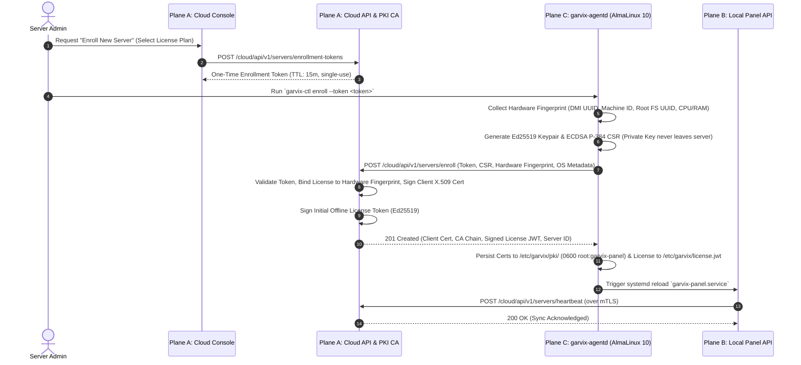
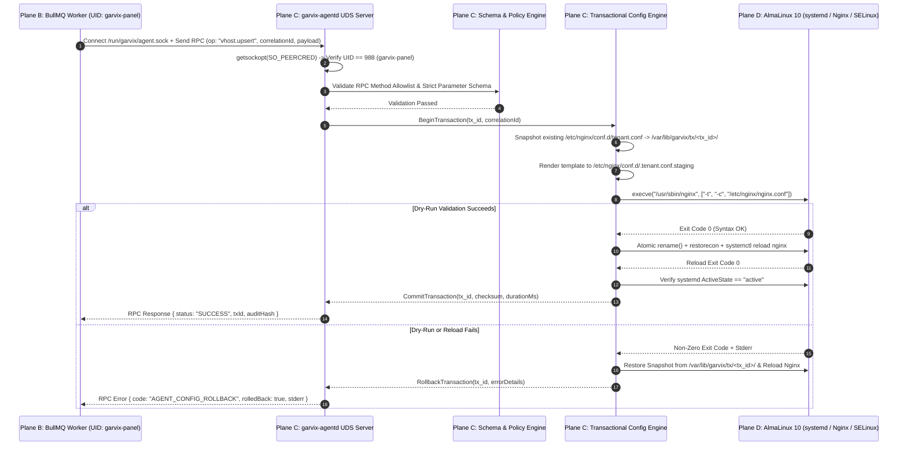
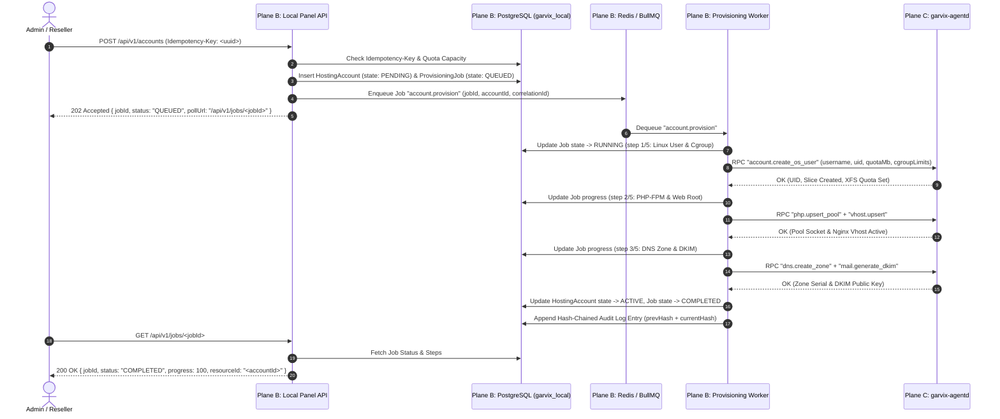
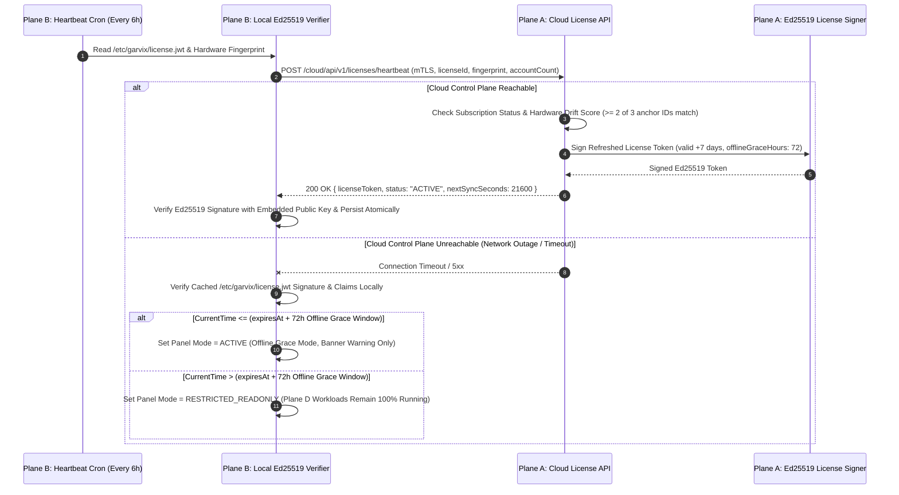

# 02 — Inter-Plane Communication Flows & IPC Protocols

**Document ID:** `GHM-ARCH-02`  
**Owner:** Garvix Software Solutions Pvt Ltd  
**Status:** Approved  

---

## 1. Communication Security Matrix

| Source Plane | Target Plane | Transport Protocol | Authentication & Integrity | Framing & Serialization |
| :--- | :--- | :--- | :--- | :--- |
| **Browser / CLI** | **Plane A (`cloud-api`)** | HTTPS (TLS 1.3) | Bearer JWT + HTTP-Only Refresh Cookie + CSRF + Step-Up Token | JSON (`application/json`) |
| **Browser / CLI** | **Plane B (`local-panel-api`)** | HTTPS (TLS 1.3, port 8443/2083) | Bearer JWT + Session ID + TOTP/WebAuthn Step-Up Token | JSON (`application/json`) |
| **Plane B (`local-panel-api`)** | **Plane A (`cloud-api`)** | HTTPS + Mutual TLS (mTLS) | Client X.509 Cert (`CN=srv_<id>`) + Ed25519 Signed Payloads | JSON (`application/json`) |
| **Plane B (`local-panel-api` / Worker)** | **Plane C (`garvix-agentd`)** | Unix Domain Socket (`/run/garvix/agent.sock`) | Kernel `SO_PEERCRED` (`UID == garvix-panel`) + HMAC-SHA256 Request Signature | 4-Byte Big-Endian Length Prefix + JSON-RPC 2.0 |

---

## 2. Flow 1: Server Enrollment & mTLS Bootstrap

When a customer purchases a license in the Garvix Cloud Console and runs the enrollment command on a fresh AlmaLinux 10 server, the server establishes a cryptographic identity and receives its signed license and client certificate.

---

## 3. Flow 2: Local Panel <-> Privileged Agent IPC over Unix Domain Socket (`SO_PEERCRED`)

All OS mutations requested by `local-panel-api` or the BullMQ provisioning worker pass over `/run/garvix/agent.sock`. The Go agent enforces a strict **5-stage transactional pipeline**:
1. **Kernel Credential & Schema Check:** Verify `SO_PEERCRED` UID/GID/PID and validate parameters against strict regex/type constraints.
2. **Snapshot Current State:** Copy affected files in `/etc` or `/var/lib` into `/var/lib/garvix/tx/<tx_id>/backup/`.
3. **Stage & Dry-Run Validate:** Render new config from compiled Go templates into `/var/lib/garvix/tx/<tx_id>/staged/` and run native syntax checkers (`nginx -t`, `named-checkzone`, `postconf -n`, `doveconf -n`).
4. **Atomic Apply & Reload:** Atomically `rename(2)` staged files into target paths, apply SELinux contexts (`restorecon`), and reload systemd units.
5. **Post-Reload Health Check & Auto-Rollback:** Verify systemd unit active state and socket responsiveness; if unhealthy, restore snapshot files and reload immediately.

---

## 4. Flow 3: Asynchronous Provisioning State Machine (BullMQ -> Local API -> Go Agent -> Audit Log)

Operations that mutate multiple OS subsystems (such as provisioning a hosting account, issuing ACME certificates, or running a Restic backup) execute asynchronously using idempotent BullMQ jobs.

---

## 5. Flow 4: Offline-Capable Ed25519 License Validation & Heartbeat Sync

