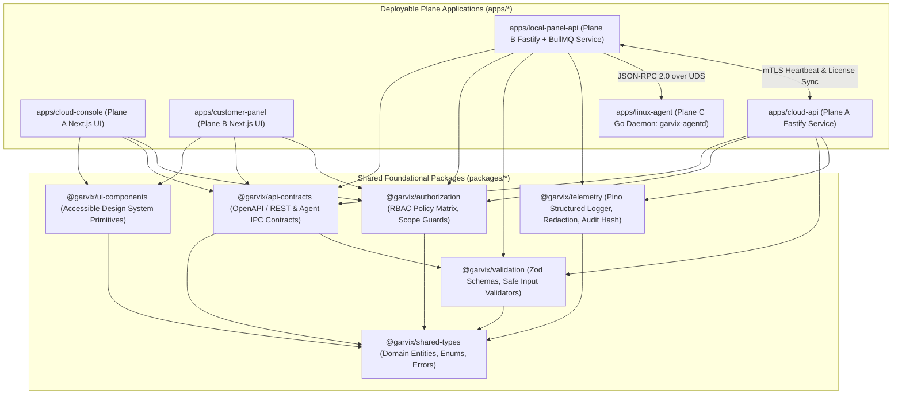
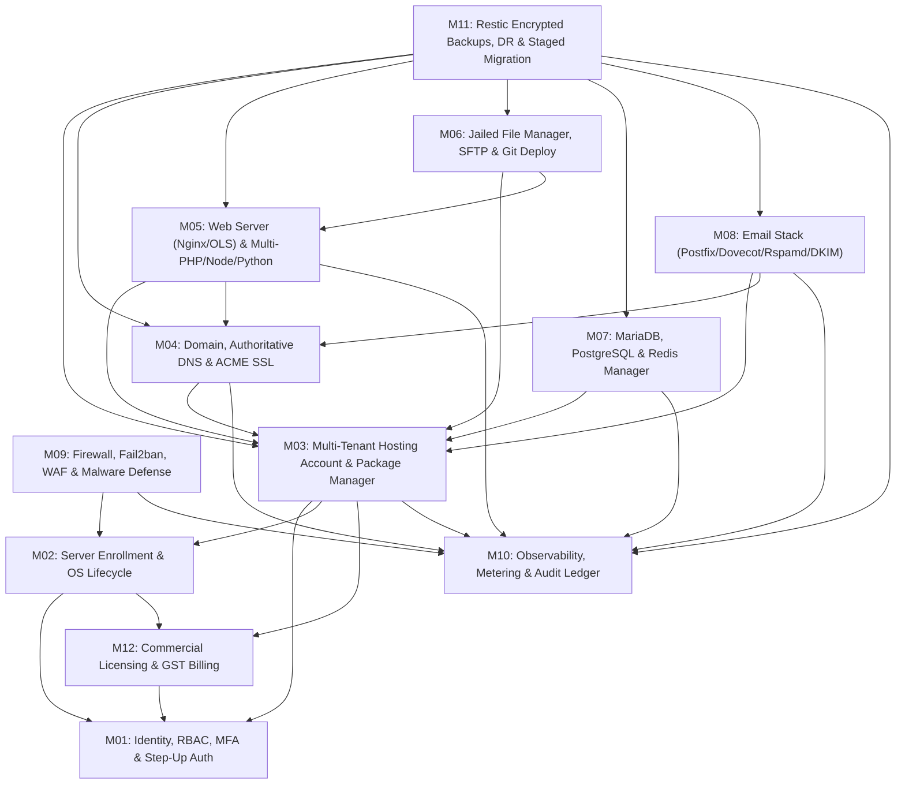
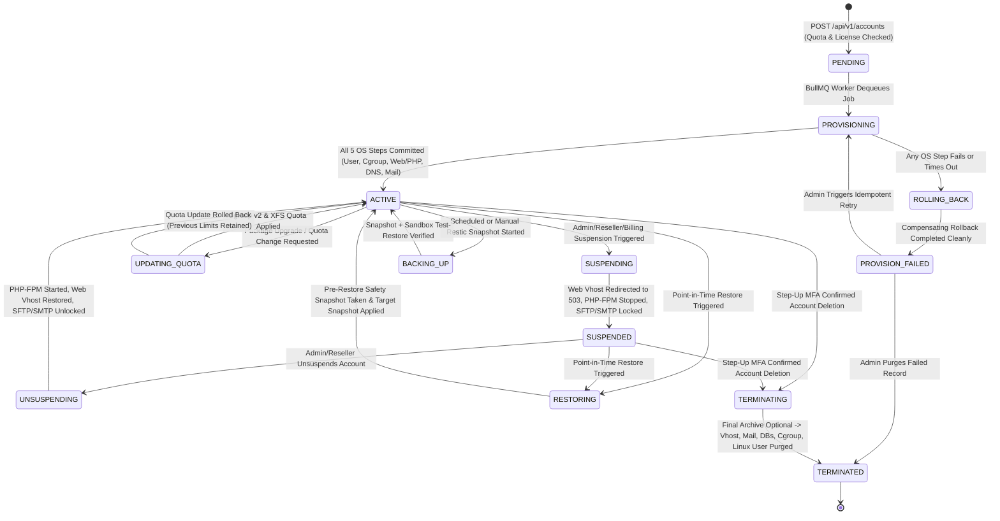

# 03 — Module Dependency Graph & State Machines

**Document ID:** `GHM-ARCH-03`  
**Owner:** Garvix Software Solutions Pvt Ltd  
**Status:** Approved  

---

## 1. Monorepo Package & Application Dependency Graph

Garvix Hosting Manager is structured as a strict, acyclic TypeScript + Go monorepo. Shared packages (`packages/*`) have zero circular dependencies and are consumed by the deployable applications (`apps/*`).

---

## 2. Product Module Inter-Dependency Graph (All 12 Modules)

Every product capability belongs to one of the 12 core modules. Lower-level infrastructure modules (`M01 Identity`, `M02 Server Lifecycle`, `M10 Observability`) provide foundational primitives to higher-level tenant workload modules (`M03 Accounts`, `M04 Domains/DNS/SSL`, `M05 Web/App`, `M06 Files/Git`, `M07 Databases`, `M08 Email`, `M09 Security`, `M11 Backups`).

---

## 3. Hosting Account Provisioning & Lifecycle State Machine

A Hosting Account in `garvix_local` transitions deterministically through explicit states. No partial failure leaves orphan Linux users, dangling PHP-FPM sockets, or broken Nginx configs on the host.

---

## 4. Compensating Rollback Matrix During Account Provisioning

If `PROVISIONING` fails at Step $N$, the BullMQ worker invokes `garvix-agentd` compensating actions in reverse order ($N-1 \dots 1$) before transitioning the record to `PROVISION_FAILED`:

| Step # | Provisioning Action | Forward Agent RPC | Compensating Rollback RPC |
| :--- | :--- | :--- | :--- |
| **Step 1** | Create Linux user, `/home/<user>` skeleton, XFS quota, `garvix-tenant-<id>.slice` | `account.create_os_user` | `account.purge_os_user` (removes slice, quota, user, `/home/<user>`) |
| **Step 2** | Create per-user PHP-FPM pool config & start socket | `php.upsert_pool` | `php.remove_pool` |
| **Step 3** | Render Nginx/OLS vhost for primary domain & reload web server | `vhost.upsert` | `vhost.remove` |
| **Step 4** | Create authoritative DNS zone & default records (`A`, `AAAA`, `MX`, `SPF`, `DMARC`) | `dns.create_zone` | `dns.delete_zone` |
| **Step 5** | Generate 2048-bit/Ed25519 DKIM keypair, publish DNS TXT, enable mail domain | `mail.provision_domain` | `mail.remove_domain` |
