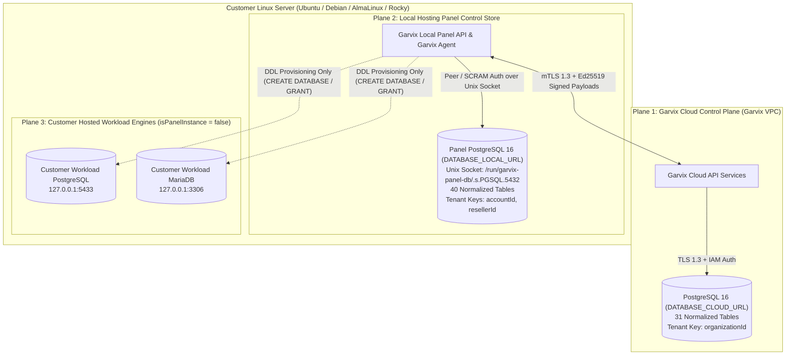
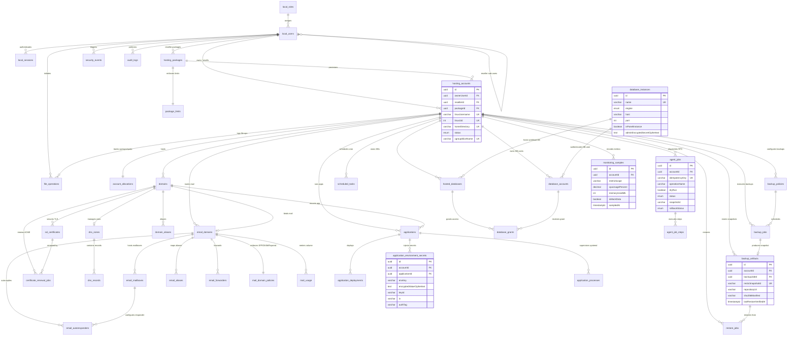
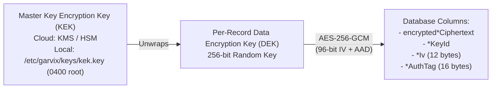

# 04 — Database Architecture, Isolation & Entity-Relationship Diagrams (ERD)

**Product:** Garvix Hosting Manager  
**Organization:** Garvix Software Solutions Pvt Ltd  
**Schemas:**
- Cloud Control Plane: [`database/cloud/schema.prisma`](file:///Users/vishnubaldwa/Documents/cpanel/database/cloud/schema.prisma) (`DATABASE_CLOUD_URL`)
- Customer Local Hosting Panel: [`database/local/schema.prisma`](file:///Users/vishnubaldwa/Documents/cpanel/database/local/schema.prisma) (`DATABASE_LOCAL_URL`)
- Deterministic Seed Suites: [`database/cloud/seed.ts`](file:///Users/vishnubaldwa/Documents/cpanel/database/cloud/seed.ts) & [`database/local/seed.ts`](file:///Users/vishnubaldwa/Documents/cpanel/database/local/seed.ts)
- Migration Policy: [`database/MIGRATION_POLICY.md`](file:///Users/vishnubaldwa/Documents/cpanel/database/MIGRATION_POLICY.md)

---

## 1. Strict Three-Plane Physical & Logical Database Isolation Policy

Garvix Hosting Manager enforces an air-tight **Three-Plane Database Isolation Architecture** so that a compromise, runaway query, or connection-pool exhaustion in one plane can never cascade into another plane.

### 1.1 Isolation Invariants

| Isolation Boundary | Enforcement Mechanism | Security Guarantee |
| :--- | :--- | :--- |
| **Cloud Control Plane vs. Customer Servers** | `DATABASE_CLOUD_URL` runs inside Garvix's private cloud subnet with zero public IP exposure. Customer servers never receive database credentials; they communicate exclusively with Cloud API endpoints via mTLS (`ServerAgentCertificate`). | A root compromise on a customer VPS cannot read or mutate any Cloud Control Plane table. |
| **Local Panel DB vs. Customer Hosted Workloads** | The Local Panel database (`DATABASE_LOCAL_URL`) runs as a dedicated `garvix-panel-postgres` systemd service listening on `/run/garvix-panel-db` (`chmod 0750`, owned by `garvix-panel:garvix-panel`). Customer workload databases run on separate clusters (`MariaDB :3306`, `PostgreSQL :5433`) registered in `database_instances` with `isPanelInstance = false`. | Customer PHP/Node.js/Python apps and `phpMyAdmin`/`pgAdmin` sessions cannot connect to, enumerate, or DoS the panel's internal PostgreSQL instance. |
| **Multi-Tenant Row Isolation (Cloud)** | Every tenant-owned table in `database/cloud/schema.prisma` carries an indexed `organizationId @db.Uuid` column and is queried through a Prisma Client Extension that injects `WHERE organization_id = :ctxOrgId AND deleted_at IS NULL`. | Prevents horizontal privilege escalation (IDOR) between organizations. |
| **Multi-Tenant Row Isolation (Local Panel)** | Every tenant-owned table in `database/local/schema.prisma` carries `accountId @db.Uuid` and `resellerId @db.Uuid?`. Reseller queries automatically filter by `resellerId = :ctxResellerId`, and Hosting Account queries filter by `accountId = :ctxAccountId`. | Resellers can only view/manage accounts they own; account owners and sub-users are strictly jailed to their `accountId`. |

---

## 2. Cloud Control Plane ERD (`database/cloud/schema.prisma`)

The Cloud Control Plane database contains **31 normalized tables** organized across 6 bounded domains:
1. **IAM, Tenancy & RBAC** (`organizations`, `organization_members`, `users`, `user_authenticators`, `roles`, `permissions`, `role_permissions`, `organization_member_roles`, `customer_profiles`)
2. **Server Fleet & mTLS Identity** (`servers`, `server_enrollments`, `server_agent_certificates`, `server_heartbeats`)
3. **Licensing & Cryptographic Entitlements** (`license_plans`, `licenses`, `license_entitlements`, `license_activations`, `license_validation_events`)
4. **Subscriptions, GST Billing & Payments** (`subscriptions`, `invoices`, `invoice_items`, `payments`, `payment_webhook_events`, `credit_notes`)
5. **Software Releases & Fleet Updates** (`update_channels`, `software_releases`, `release_artifacts`, `server_update_history`)
6. **Support, Security Telemetry & Audit Logs** (`support_tickets`, `security_events`, `audit_logs`)

```mermaid
erDiagram
  organizations ||--o{ organization_members : "has members"
  organizations ||--o| customer_profiles : "has GST profile"
  organizations ||--o{ servers : "owns fleet"
  organizations ||--o{ licenses : "holds licenses"
  organizations ||--o{ subscriptions : "subscribes"
  organizations ||--o{ invoices : "billed via"
  organizations ||--o{ payments : "pays"
  organizations ||--o{ credit_notes : "credited via"
  organizations ||--o{ support_tickets : "opens"
  organizations ||--o{ security_events : "emits"
  organizations ||--o{ audit_logs : "audits"

  users ||--o{ organization_members : "joins orgs"
  users ||--o{ user_authenticators : "enrolls MFA"
  users ||--o{ support_tickets : "creates"
  users ||--o{ security_events : "triggers"
  users ||--o{ audit_logs : "performs"

  organization_members ||--o{ organization_member_roles : "assigned"
  roles ||--o{ organization_member_roles : "grants role"
  roles ||--o{ role_permissions : "includes"
  permissions ||--o{ role_permissions : "mapped to"

  update_channels ||--o{ software_releases : "publishes"
  update_channels ||--o{ servers : "tracks channel"
  software_releases ||--o{ release_artifacts : "packages"
  software_releases ||--o{ server_update_history : "applied in"

  servers ||--o{ server_enrollments : "enrolls via"
  servers ||--o{ server_agent_certificates : "authenticates via"
  servers ||--o{ server_heartbeats : "reports health"
  servers ||--o{ licenses : "bound to"
  servers ||--o{ license_activations : "activates"
  servers ||--o{ license_validation_events : "validates"
  servers ||--o{ server_update_history : "upgrades"
  servers ||--o{ support_tickets : "references"

  license_plans ||--o{ licenses : "defines tier"
  license_plans ||--o{ subscriptions : "bills plan"
  subscriptions ||--o{ licenses : "provisions"
  subscriptions ||--o{ invoices : "generates"

  licenses ||--o{ license_entitlements : "unlocks"
  licenses ||--o{ license_activations : "records binding"
  licenses ||--o{ license_validation_events : "logs checks"

  invoices ||--o{ invoice_items : "contains line items"
  invoices ||--o{ payments : "settled by"
  invoices ||--o{ credit_notes : "adjusted by"

  organizations {
    uuid id PK
    varchar slug UK
    varchar name
    enum status
    timestamptz createdAt
    timestamptz deletedAt
  }
  users {
    uuid id PK
    varchar email UK
    text passwordArgon2Hash
    boolean mfaEnforced
    boolean isPlatformStaff
    timestamptz deletedAt
  }
  user_authenticators {
    uuid id PK
    uuid userId FK
    enum type
    text encryptedSecretCiphertext
    varchar secretKeyId
    jsonb recoveryCodeHashesJson
  }
  organization_members {
    uuid id PK
    uuid organizationId FK
    uuid userId FK
    enum status
  }
  roles {
    uuid id PK
    uuid organizationId FK
    varchar code UK
    enum scope
  }
  permissions {
    uuid id PK
    varchar key UK
    varchar module
    boolean isHighRisk
  }
  role_permissions {
    uuid id PK
    uuid roleId FK
    uuid permissionId FK
  }
  organization_member_roles {
    uuid id PK
    uuid organizationId
    uuid organizationMemberId FK
    uuid roleId FK
  }
  customer_profiles {
    uuid id PK
    uuid organizationId FK
    varchar gstin
    varchar stateCode
    enum taxExemptionStatus
    enum currency
  }
  servers {
    uuid id PK
    uuid organizationId FK
    varchar hardwareFingerprint UK
    enum osFamily
    varchar primaryIp
    enum enrollmentStatus
  }
  server_enrollments {
    uuid id PK
    uuid organizationId FK
    uuid serverId FK
    varchar enrollmentTokenHash UK
    text csrPem
    varchar mtlsIdentitySpiffe UK
  }
  server_agent_certificates {
    uuid id PK
    uuid organizationId FK
    uuid serverId FK
    varchar serialNumberHex UK
    varchar sha256Fingerprint UK
    timestamptz issuedAt
    timestamptz expiresAt
    timestamptz revokedAt
  }
  server_heartbeats {
    uuid id PK
    uuid organizationId FK
    uuid serverId FK
    varchar agentVersion
    varchar panelVersion
    decimal loadAvg1m
    int memoryUsedMb
    int diskUsedGb
    boolean servicesHealthy
  }
  license_plans {
    uuid id PK
    varchar code UK
    enum tier
    int maxAccounts
    int maxServers
    int offlineGraceHours
    bigint pricePaise
  }
  licenses {
    uuid id PK
    uuid organizationId FK
    uuid planId FK
    uuid boundServerId FK
    varchar licenseKeyPrefix
    varchar licenseKeyHash UK
    enum status
    text ed25519Signature
    timestamptz issuedAt
    timestamptz expiresAt
    timestamptz graceEndsAt
  }
  license_entitlements {
    uuid id PK
    uuid organizationId
    uuid licenseId FK
    varchar featureKey
    int limitValue
    boolean enabled
  }
  license_activations {
    uuid id PK
    uuid organizationId FK
    uuid licenseId FK
    uuid serverId FK
    varchar hardwareFingerprint
    varchar ipAddress
    timestamptz activatedAt
    timestamptz deactivatedAt
  }
  license_validation_events {
    uuid id PK
    uuid organizationId FK
    uuid licenseId FK
    uuid serverId FK
    enum result
    varchar agentVersion
    varchar ipAddress
    timestamptz createdAt
  }
  subscriptions {
    uuid id PK
    uuid organizationId FK
    uuid planId FK
    enum billingCycle
    enum status
    timestamptz currentPeriodStart
    timestamptz currentPeriodEnd
    varchar providerSubscriptionId UK
  }
  invoices {
    uuid id PK
    varchar invoiceNumber UK
    uuid organizationId FK
    uuid subscriptionId FK
    bigint subtotalPaise
    bigint cgstPaise
    bigint sgstPaise
    bigint igstPaise
    bigint totalPaise
    enum status
    varchar immutableHash UK
  }
  invoice_items {
    uuid id PK
    uuid organizationId
    uuid invoiceId FK
    varchar sacCode
    int quantity
    bigint unitPricePaise
    bigint amountPaise
  }
  payments {
    uuid id PK
    uuid invoiceId FK
    uuid organizationId FK
    enum provider
    varchar providerPaymentId UK
    bigint amountPaise
    varchar idempotencyKey UK
    enum status
  }
  payment_webhook_events {
    uuid id PK
    enum provider
    varchar eventId
    varchar eventType
    boolean signatureVerified
    jsonb payloadJson
    enum status
  }
  credit_notes {
    uuid id PK
    varchar creditNoteNumber UK
    uuid invoiceId FK
    uuid organizationId FK
    bigint subtotalPaise
    bigint taxAdjustmentPaise
    bigint totalPaise
    varchar immutableHash UK
  }
  update_channels {
    uuid id PK
    enum name UK
    text description
  }
  software_releases {
    uuid id PK
    varchar version
    uuid channelId FK
    enum component
    varchar minOsVersion
    text ed25519ManifestSignature
  }
  release_artifacts {
    uuid id PK
    uuid releaseId FK
    enum osTarget
    enum arch
    varchar sha256Checksum
    text ed25519Signature
  }
  server_update_history {
    uuid id PK
    uuid organizationId FK
    uuid serverId FK
    uuid releaseId FK
    varchar fromVersion
    varchar toVersion
    enum status
    boolean rollbackExecuted
  }
  support_tickets {
    uuid id PK
    varchar ticketNumber UK
    uuid organizationId FK
    uuid serverId FK
    uuid createdByUserId FK
    enum priority
    enum status
  }
  security_events {
    uuid id PK
    uuid organizationId FK
    uuid serverId FK
    uuid actorUserId FK
    enum severity
    varchar eventType
    varchar ipAddress
  }
  audit_logs {
    uuid id PK
    uuid organizationId FK
    uuid actorUserId FK
    varchar actorRole
    varchar action
    varchar resourceType
    varchar resourceId
    varchar requestId
  }
```

---

## 3. Customer Local Hosting Panel ERD (`database/local/schema.prisma`)

The Customer Local Hosting Panel database contains **40 normalized tables** organized across 9 bounded domains:
1. **Local IAM, Roles & Sessions** (`local_roles`, `local_users`, `local_sessions`)
2. **Packages, Hosting Accounts & cgroups v2 Allocations** (`hosting_packages`, `package_limits`, `hosting_accounts`, `account_allocations`)
3. **Domains, DNS Zones & ACME SSL Certificates** (`domains`, `domain_aliases`, `dns_zones`, `dns_records`, `ssl_certificates`, `certificate_renewal_jobs`)
4. **Email Domains, Mailboxes, Policies & Usage** (`email_domains`, `email_mailboxes`, `email_aliases`, `email_forwarders`, `email_autoresponders`, `mail_domain_policies`, `mail_usage`)
5. **Customer Workload Databases** (`database_instances`, `hosted_databases`, `database_accounts`, `database_grants`)
6. **Applications, Deployments, Secrets & Processes** (`applications`, `application_deployments`, `application_environment_secrets`, `application_processes`)
7. **File Operations & Scheduled Cron Tasks** (`file_operations`, `scheduled_tasks`)
8. **Restic Backups, Artifacts & Restore Jobs** (`backup_policies`, `backup_jobs`, `backup_artifacts`, `restore_jobs`)
9. **Privileged Agent Jobs, Telemetry, Security & Audit Logs** (`agent_jobs`, `agent_job_steps`, `service_status_events`, `monitoring_samples`, `security_events`, `audit_logs`)

---

## 4. Cryptographic Storage & Envelope Encryption Architecture (AES-256-GCM)

Garvix Hosting Manager **never stores plaintext passwords, private keys, or secret environment variables** in either PostgreSQL database. Every credential is classified into one of three cryptographic storage patterns:

### 4.1 One-Way Password & Token Hashing (Non-Reversible)

| Secret Category | Target Table & Column | Algorithm & Parameters |
| :--- | :--- | :--- |
| Cloud & Local User Passwords | `users.passwordArgon2Hash`, `local_users.passwordArgon2Hash` | **Argon2id** (`v=19`, `m=65536` KiB, `t=3`, `p=4`, 16-byte random salt) |
| Mailbox Passwords (Dovecot) | `email_mailboxes.passwordDovecotHash` | **Dovecot `{ARGON2ID}`** (or `{BLF-CRYPT}` / `{SHA512-CRYPT}` for legacy migration compatibility) |
| Customer Workload DB Users | `database_accounts.passwordAuthHash` | Native engine verifier (`SCRAM-SHA-256` for PostgreSQL 16; `caching_sha2_password` / `mysql_native_password` hash for MariaDB) |
| License Keys, Enrollment Tokens, Session Tokens, Recovery Codes | `licenses.licenseKeyHash`, `server_enrollments.enrollmentTokenHash`, `local_sessions.sessionTokenHash`, `user_authenticators.recoveryCodeHashesJson` | **SHA-256** hex digest (with `licenseKeyPrefix` stored separately for UI identification) |

### 4.2 Reversible Secrets via Envelope Encryption (AES-256-GCM with KEK/DEK Rotation)

Certain secrets must be decrypted at runtime by `garvix-agent` or the Control Plane (e.g., TOTP seed secrets, TLS private keys, DKIM signing private keys, workload DB root/admin credentials, Restic repository credentials, and customer application environment secrets).

1. **Key Hierarchy:**
   - **Key Encryption Key (KEK):** Identified by `keyId` (e.g., `kek-cloud-2026-q1` in Cloud KMS, or `kek-local-node-2026-01` stored in `/etc/garvix/keys/` with `0400` root-only permissions and systemd `LoadCredentialEncrypted=` support).
   - **Data Encryption Key (DEK):** Generated per secret via CSPRNG (`crypto.randomBytes(32)`), wrapped by the active KEK, and bound using Additional Authenticated Data (`AAD = "<tableName>:<recordId>:<tenantId>"`) so a ciphertext copied from one tenant row to another fails GCM tag authentication.
2. **Envelope-Encrypted Columns Across Schemas:**
   - `user_authenticators`: `encryptedSecretCiphertext`, `secretKeyId`, `secretIv`, `secretAuthTag`
   - `local_users`: `totpEncryptedCiphertext`, `totpKeyId`, `totpIv`, `totpAuthTag`
   - `ssl_certificates`: `encryptedPrivateKeyCiphertext`, `privateKeyId`, `privateKeyIv`, `privateKeyAuthTag`
   - `email_domains`: `dkimEncryptedKeyCiphertext`, `dkimKeyId`, `dkimIv`, `dkimAuthTag`
   - `database_instances`: `adminEncryptedSecretCiphertext`, `adminSecretKeyId`, `adminSecretIv`, `adminSecretAuthTag`
   - `application_environment_secrets`: `encryptedValueCiphertext`, `keyId`, `iv`, `authTag`
   - `backup_policies`: `encryptedRepoSecretCiphertext`, `repoSecretKeyId`, `repoSecretIv`, `repoSecretAuthTag`
3. **Zero-Downtime KEK Rotation:**
   - Because every encrypted row stores its `keyId` (indexed on `application_environment_secrets(accountId, keyId)`), rotating to a new KEK (`kek-2026-q2`) simply re-wraps DEKs in a background batch job without taking the panel offline.

---

## 5. Migration Strategy, Compatibility & Data Retention Policies

### 5.1 Forward & Backward Compatibility Policy
- **Expand-Migrate-Contract:** All schema changes across Cloud and Local databases must be backward-compatible with at least version $N-1$ of the application binaries.
- **Pre-Migration Automated Snapshots:** On Customer Local Hosting Panels, `garvix-agent` automatically creates a logical `pg_dump` backup of `DATABASE_LOCAL_URL` prior to applying any Prisma migration during `ServerUpdateHistory` execution, enabling deterministic rollback if any migration or post-upgrade health check fails.

### 5.2 Statutory Retention & Soft-Delete Policy

| Domain / Table Group | Soft-Delete (`deletedAt`) | Hard-Purge / Archival Window | Compliance & Statutory Basis |
| :--- | :--- | :--- | :--- |
| **GST Invoices, Invoice Items, Credit Notes, Payments** (`invoices`, `invoice_items`, `credit_notes`, `payments`) | Immutable (`immutableHash` SHA-256 chain); `deletedAt` never set on issued invoices (corrections via `CreditNote` only) | **8 Years** minimum retention in active + WORM object storage | Section 36 of the Central Goods and Services Tax (CGST) Act, 2017 (India) |
| **Security Events & Audit Logs** (`security_events`, `audit_logs`) | Append-only (`integrityHash` chained) | **180 Days** hot PostgreSQL retention + **5 Years** cold compressed archive | CERT-In Directions (April 2022) mandatory 180-day ICT log retention |
| **Server Heartbeats & Monitoring Samples** (`server_heartbeats`, `monitoring_samples`) | Not applicable (time-series telemetry) | **30 Days** high-resolution retention in PostgreSQL; rolled up daily thereafter | Operational capacity management; synthetic test rows flagged via `isMockData = true` |
| **Hosting Accounts, Domains, Mailboxes, Hosted Databases** | Soft-deleted (`deletedAt` set on termination) | **30-Day Quarantine Grace Window** before metadata purge (coupled with final Restic archive snapshot) | Protects customers against accidental account or domain deletion |
