# 07 — Complete Email Hosting & Deliverability Infrastructure

**Document ID:** `GHM-ARCH-07`  
**Owner:** Garvix Software Solutions Pvt Ltd  
**Status:** Approved  

---

## 1. Email Stack Architecture Overview

Garvix Hosting Manager provides a complete, security-hardened, multi-tenant email hosting suite engineered to prevent open relays, enforce strict outbound rate limits, automate cryptographic authentication (SPF, DKIM, DMARC, ARC), and survive VPS provider port-25 blocks via seamless SMTP relay fallback.

### Core Daemons & Responsibilities
| Component | Technology | Role in GHM Mail Pipeline |
| :--- | :--- | :--- |
| **MTA (Inbound & Outbound)** | **Postfix 3.8+** | SMTP receiver (`25/tcp`), Authenticated Submission (`587/tcp` STARTTLS, `465/tcp` Implicit TLS), queue management, SNI TLS certificates, and outbound delivery/relay routing. |
| **MDA & IMAP/POP3 Server** | **Dovecot 2.3+** | LMTP local mail delivery (`/run/dovecot/lmtp`), SASL authentication backend (`/run/dovecot/auth-client`) using Argon2id hashes, Maildir++ storage, per-mailbox quotas, and Sieve filtering (`4190/tcp` ManageSieve). |
| **Spam, Phishing & DKIM Milter** | **Rspamd 3.8+** | Postfix `smtpd_milters` integration (`127.0.0.1:11332`), inbound spam scoring, Bayesian/fuzzy hashing, greylisting, outbound 2048-bit RSA & Ed25519 DKIM/ARC signing, and per-user/per-domain outbound rate limiting (ratelimit module backed by Redis). |
| **Antivirus Attachment Scanner** | **ClamAV (`clamd`)** | Integrated via Rspamd antivirus module to scan inbound/outbound MIME attachments on demand or quarantine infected payloads. |
| **Webmail Client** | **Roundcube 1.6 LTS** | Hardened PHP-FPM pool (`garvix-roundcube`), pre-configured with `managesieve` (autoresponders/filters), `password` (Local Panel API webhook), and CardDAV/CalDAV plugins. |

---

## 2. Inbound & Outbound Mail Flow Diagram

```mermaid
flowchart TD
    subgraph InboundFlow["Inbound Mail Flow (Internet -> Customer Mailbox)"]
        ExtMTA["External Sending MTA"] -->|"TCP 25 (ESMTP + STARTTLS)"| PostfixIn["Postfix smtpd (Postscreen + DNSBL + HELO/PTR Check)"]
        PostfixIn -->|"Milter Protocol (127.0.0.1:11332)"| RspamdIn["Rspamd Inbound Filter (SPF, DKIM, DMARC, Fuzzy, Bayes, ClamAV)"]
        RspamdIn -->|"Score >= Reject Threshold (15.0)"| Reject554["554 5.7.1 Spam Rejected at SMTP Edge"]
        RspamdIn -->|"Score >= Add Header (6.0) or Clean"| PostfixLMTP["Postfix Virtual Transport"]
        PostfixLMTP -->|"Unix Socket (/run/dovecot/lmtp)"| DovecotLMTP["Dovecot LMTP + Sieve Engine"]
        DovecotLMTP -->|"X-Spam: Yes"| JunkDir["/home/<tenant>/mail/<domain>/<user>/.Junk"]
        DovecotLMTP -->|"Clean + Autoresponder Check"| InboxDir["/home/<tenant>/mail/<domain>/<user>/cur"]
    end

    subgraph OutboundFlow["Outbound Submission Flow (Authenticated User / Webmail -> Internet)"]
        MailClient["MUA / Roundcube Webmail"] -->|"TCP 465 (TLS) or 587 (STARTTLS)"| PostfixSub["Postfix Submission Service"]
        PostfixSub -->|"SASL Auth (/run/dovecot/auth-client)"| DovecotAuth["Dovecot Auth (Argon2id Verify + Sender Login Match)"]
        PostfixSub -->|"Milter Protocol"| RspamdOut["Rspamd Outbound (Per-User/Domain Rate Limit + Outbound Spam Check + Dual RSA-2048/Ed25519 DKIM Sign)"]
        RspamdOut -->|"TCP 25 Direct Open"| DirectMX["Direct MX Delivery (IPv4/IPv6 + DANE/MTA-STS)"]
        RspamdOut -->|"TCP 25 Blocked or Relay Enabled"| SmartRelay["Authenticated Smart Host Relay (SES / Mailgun / SendGrid / Custom SMTP:587)"]
    end
```



---

## 3. Authentication, Password Hashing & No-Open-Relay Hardening

### 3.1 Argon2id Mailbox Credential Storage
- Mailbox passwords are **never** stored in plaintext or weak hashes (MD5/SHA1).
- Local Panel API hashes mailbox passwords using **Argon2id** (`{ARGON2ID}$argon2id$v=19$m=65536,t=3,p=4$...`) compatible with Dovecot's `password_scheme = ARGON2ID`.
- Account suspension or compromised-mailbox detection atomically sets `active = false` and `smtp_send_enabled = false` in the virtual mailbox lookup table, terminating active IMAP/SMTP sessions immediately via `doveadm kick`.

### 3.2 Strict Anti-Open-Relay & Anti-Spoofing Controls
Postfix `main.cf` and `master.cf` are rendered from immutable templates inside `garvix-agentd`:
```ini
# Strict Relay & Sender Spoofing Prevention
mynetworks = 127.0.0.0/8 [::1]/128
smtpd_relay_restrictions =
    permit_mynetworks,
    permit_sasl_authenticated,
    defer_unauth_destination

# Prevent authenticated user A@domain1.com from spoofing From: B@domain2.com
smtpd_sender_login_maps = pgsql:/etc/postfix/pgsql-sender-login-maps.cf
smtpd_sender_restrictions =
    reject_non_fqdn_sender,
    reject_unknown_sender_domain,
    reject_authenticated_sender_login_mismatch,
    permit_sasl_authenticated,
    permit_mynetworks

# Disable VRFY and enforce HELO
disable_vrfy_command = yes
smtpd_helo_required = yes
```
- **Local PHP `sendmail` / `mail()` Hardening:** PHP-FPM pools have `mail.add_x_header = On` and invoke `/usr/sbin/garvix-sendmail-wrapper`, which injects the tenant UID/domain header, enforces the per-tenant hourly send quota, and blocks unauthenticated PHP scripts if the tenant has disabled local script mail.

---

## 4. Cryptographic Email Authentication (DKIM, SPF, DMARC)

### 4.1 Automated Dual DKIM Key Generation & Rotation
When a domain's email routing is enabled (`LOCAL`), `garvix-agentd` generates two DKIM keypairs in `/var/lib/rspamd/dkim/<domain>/`:
1. **Primary Selector (`ghm2048`):** 2048-bit RSA key for universal compatibility.
2. **Modern Selector (`ghmed25519`):** Ed25519 key for RFC 8463 dual-signing.
- Private keys are owned `0600 _rspamd:_rspamd`.
- If the domain uses Garvix Authoritative DNS (PowerDNS), the `ghm2048._domainkey.<domain>` and `ghmed25519._domainkey.<domain>` TXT records are published automatically. If external DNS is used, the Email Deliverability Wizard displays one-click copyable DNS records and runs continuous DNS verification checks.

### 4.2 SPF & DMARC Configuration Wizard
- **Default SPF Record:** `v=spf1 a mx ip4:<SERVER_IPV4> ip6:<SERVER_IPV6> ~all` (automatically appends `include:<relay_spf>` when an outbound SMTP relay is configured).
- **Default DMARC Record:** `v=DMARC1; p=quarantine; rua=mailto:dmarc-reports@<domain>; adkim=s; aspf=s; pct=100` with guided progression from `p=none` -> `p=quarantine` -> `p=reject`.

---

## 5. Outbound Rate Limiting & Reputation Protection

To prevent a single compromised WordPress site or phished mailbox from blacklisting the server's primary IPv4 address:
1. **Per-Mailbox Hourly Limit:** Default `150 messages/hour` (configurable per mailbox or hosting plan).
2. **Per-Domain Hourly Limit:** Default `500 messages/hour` (configurable per hosting package).
3. **Outbound Spam Circuit Breaker:** If a mailbox or domain triggers `> 10` outbound spam rejections (`Rspamd score >= 12.0`) or `> 15%` hard bounce rate over a Rolling 1-Hour window (`>= 50` emails), `garvix-agentd` automatically pauses outbound SMTP for that mailbox/domain, alerts the Server Admin and Account Owner, and logs an incident in the audit ledger.

---

## 6. 13-Point Mail Server Deliverability Preflight Check

Before enabling production email or diagnosing deliverability issues, the `mail.preflight_check` Agent RPC executes a comprehensive **13-point automated diagnostic**:

| Check # | Diagnostic Check ID | Verification Method | Remediation / Fallback Provided by GHM |
| :--- | :--- | :--- | :--- |
| **1** | `OUTBOUND_TCP_25_CONNECTIVITY` | Direct TCP handshake test from server IP to Gmail/Cloudflare MX on port 25 (5s timeout). | If blocked by cloud provider (AWS/GCP/Hetzner/Vultr), prompts admin to configure **Outbound SMTP Relay Fallback** (Port 587/465/API). |
| **2** | `INBOUND_TCP_25_587_465_993_OPEN` | Checks local nftables/firewalld rules and socket listeners for `25, 465, 587, 993`. | One-click firewall rule remediation via `garvix-agentd`. |
| **3** | `PTR_RDNS_ALIGNMENT` | Queries reverse DNS (`PTR`) of server primary IPv4 & IPv6 and verifies it matches `myhostname` (`mail.<server-hostname>`). | Displays exact PTR record value to set in the VPS provider's network console. |
| **4** | `FCrDNS_FORWARD_CONFIRMATION` | Verifies that the hostname returned by `PTR` resolves back (`A`/`AAAA`) to the exact server IP. | Auto-creates matching `A`/`AAAA` record if zone is hosted locally. |
| **5** | `HELO_EHLO_BANNER_MATCH` | Verifies Postfix `smtpd_banner` and `myhostname` match the FCrDNS hostname. | Auto-updates Postfix `myhostname` transactionally. |
| **6** | `TLS_CERT_VALIDITY_AND_SNI` | Verifies Postfix & Dovecot TLS certificates ( plus per-domain SNI maps) are valid and not expiring within 14 days. | Triggers immediate ACME certificate issuance/renewal and rebuilds `postmap -F hash:/etc/postfix/vmail_ssl.map`. |
| **7** | `MX_RECORD_RESOLUTION` | Queries public resolvers (`1.1.1.1`, `8.8.8.8`) for domain `MX` records and verifies target host resolution. | Auto-repairs local zone or displays required external DNS change. |
| **8** | `SPF_SYNTAX_AND_LOOKUP_COUNT` | Parses domain `TXT` SPF record, verifies server IP / Relay inclusion, and ensures DNS lookup count `<= 10` (RFC 7208). | Generates flattened/valid SPF record string. |
| **9** | `DKIM_KEY_AND_DNS_MATCH` | Verifies local private key in `/var/lib/rspamd/dkim/` matches the public key published at `<selector>._domainkey.<domain>`. | One-click re-publish or key rotation. |
| **10** | `DMARC_POLICY_VALIDATION` | Validates `_dmarc.<domain>` TXT record syntax, policy tag (`p=`), and alignment flags. | Guided DMARC policy builder. |
| **11** | `IPV4_DNSBL_REPUTATION` | Checks server IPv4 against major DNSBLs (Spamhaus ZEN, Barracuda, SpamCop, SORBS). | Links delisting instructions or enables clean Outbound SMTP Relay bypass. |
| **12** | `OPEN_RELAY_SELF_TEST` | Simulates unauthenticated external sender attempting to relay to an external recipient address. | Asserts `554 5.7.1 Relay access denied`; halts outbound service if misconfigured. |
| **13** | `QUEUE_HEALTH_AND_DISK_SPACE` | Verifies `/var/spool/postfix` and `/home` have `> 15%` free disk/inodes and deferred queue `< 200` messages. | Alerts admin and provides deferred queue inspection / flush / purge controls. |

---

## 7. Outbound SMTP Relay Fallback (Port 25 Blocked Environments)

Many cloud and VPS providers block outbound TCP port 25 by default. GHM supports **Dual-Scope Outbound SMTP Relay**:
- **Server-Wide Default Relay:** Configured by `SERVER_ADMIN` (e.g., Amazon SES, Mailgun, SendGrid, Postmark, or custom SMTP Smart Host on TCP `587` or `2587`).
- **Per-Domain Custom Relay:** Configured via Postfix `sender_dependent_default_transport_maps` and `smtp_sasl_password_maps` (stored encrypted at rest in `garvix_local` and rendered `0600 root:root` in `/etc/postfix/sasl_passwd`).
- When Check #1 (`OUTBOUND_TCP_25_CONNECTIVITY`) fails, the Local Panel automatically surfaces a non-dismissible setup wizard in the Email section allowing the administrator to activate an outbound relay in under 60 seconds without losing queued messages.
