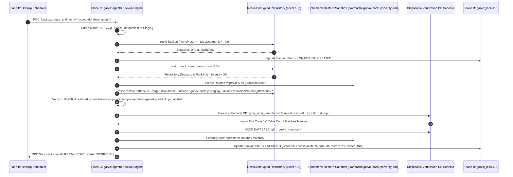

# 10 — Restic Encrypted Backups, Disaster Recovery & Staged Migration Design

**Document ID:** `GHM-OPS-10`  
**Owner:** Garvix Software Solutions Pvt Ltd  
**Status:** Approved  

---

## 1. Backup Architecture Overview (Restic Deduplicated & Encrypted)

Garvix Hosting Manager uses **Restic** orchestrated by `garvix-agentd` to deliver content-defined chunked deduplication, authenticated encryption, and multi-destination cloud storage durability.

### 1.1 Cryptographic & Storage Specifications
- **Encryption Standard:** Every backup repository is initialized with a cryptographically random 256-bit master password protecting Restic's **AES-256-CTR + Poly1305-AES** encryption and message authentication keys.
- **Key Escrow & Export:** The repository encryption key is stored encrypted at rest (AES-256-GCM) in `garvix_local`, optionally escrowed in the customer's Garvix Cloud Console vault (zero-knowledge client-encrypted option supported), and exportable by `SERVER_ADMIN` as an offline emergency recovery kit.
- **Supported Storage Targets:**
  1. **Local Secondary Disk / Mount (`/var/backups/garvix-restic`)**
  2. **S3-Compatible Object Storage (AWS S3, Backblaze B2, Cloudflare R2, Wasabi, DigitalOcean Spaces, MinIO)**
  3. **SFTP / SSH Remote Storage Server**

---

## 2. Logical + Filesystem Snapshot Pipeline

To guarantee database consistency without locking tables for extended periods, `garvix-agentd` executes a structured pre-backup dump into a private staging directory (`/home/<user>/.garvix-backup-staging/`) before invoking `restic backup`:

| Artifact Type | Extraction / Snapshot Method | Staging Path Inside Snapshot |
| :--- | :--- | :--- |
| **Account Metadata Manifest** | JSON export of domains, DNS zone records, PHP-FPM settings, cron jobs, SSL certs, and quota definitions signed with SHA-256 manifest checksum. | `/.garvix-backup-staging/account-manifest.json` |
| **MariaDB / MySQL Databases** | `mariadb-dump --single-transaction --quick --routines --triggers --events` streamed through `zstd -3` compression. | `/.garvix-backup-staging/mysql/<db_name>.sql.zst` |
| **PostgreSQL Databases** | `pg_dump --format=custom --compress=zstd:3 --no-owner --no-acl` | `/.garvix-backup-staging/pgsql/<db_name>.dump` |
| **Email Maildirs & Sieve** | Dovecot Maildir++ (`/home/<user>/mail/<domain>/`) + Sieve filters + mailbox Argon2id credential hashes & DKIM keys. | `/mail/` & `/.garvix-backup-staging/mail-metadata.json` |
| **Application & Web Files** | `/home/<user>/domains/`, `/home/<user>/apps/`, `/home/<user>/.ssh/` (excluding ephemeral caches like `/home/<user>/tmp/*`). | `/domains/`, `/apps/` |

### Default Retention Policy (`restic forget --prune`)
```text
--keep-daily 7 --keep-weekly 4 --keep-monthly 6
```
Run automatically during low-traffic maintenance windows (`03:15 local server time`) under `ionice -c2 -n7` and `nice -n 15` so customer websites experience zero I/O starvation.

---

## 3. Mandatory Automated Test-Restore Verification Pipeline

> [!IMPORTANT]
> **No Backup is Marked `VERIFIED` Without Restore Verification:** A backup job that merely exits with code `0` is recorded only as `SNAPSHOT_CREATED`. It transitions to `VERIFIED` **only** after passing automated structural integrity and sandbox test-restore verification.



---

## 4. Granular & Full Disaster Recovery Workflows

GHM supports four granular restore modes (all requiring `X-Garvix-Step-Up-Token`):
1. **Granular File / Directory Restore:** Restores selected paths either in-place (after taking an automatic pre-restore snapshot) or to `/home/<user>/restored-<timestamp>/`.
2. **Single Database Restore:** Takes an automatic pre-restore `mariadb-dump`/`pg_dump` safety snapshot of the live database before importing the selected historical snapshot.
3. **Single Mailbox / Maildir Restore:** Restores missing or deleted emails into `/home/<user>/mail/<domain>/<mailbox>/.Restored-<date>/` and runs `doveadm force-resync -u <mailbox> '*'`.
4. **Full Bare-Metal Server Disaster Recovery (`garvix-ctl dr-restore`):**
   - On a fresh AlmaLinux 10 server, the administrator installs GHM, connects the S3/SFTP Restic repository + encryption key, and runs `garvix-ctl dr-restore --all-accounts`.
   - GHM recreates all hosting packages, Linux users, XFS quotas, cgroup v2 slices, PHP-FPM pools, Nginx vhosts, DNS zones, DKIM keys, databases, and maildirs in dependency order.

---

## 5. Staged Migration Wizard (cPanel / DirectAdmin / CyberPanel / GHM Import)

Migrating live production accounts from legacy control panels is notorious for silent failures. GHM enforces a **5-Phase Staged Migration Pipeline** with zero downtime until the final DNS cutover:

### Phase 1: Archive Inspection & Checksum Verification (`ANALYZING`)
- Accepts `cpmove-<user>.tar.gz` / `backup-<date>_<user>.tar.gz` or native GHM archive via SFTP/rsync or local upload.
- Verifies archive SHA-256 checksum, scans for archive-slip (`../`) path traversal or malicious root symlinks, and extracts only the metadata headers inside an unprivileged sandbox.

### Phase 2: Explicit Resource Mapping & Conflict Report (`MAPPING_READY`)
Produces a structured dry-run compatibility report before touching the server:
- **OS & Username Collisions:** Checks if the Linux username, primary domain, or database prefix collides with an existing tenant.
- **PHP Version & Extension Mapping:** Maps legacy PHP versions (e.g., PHP 7.4 -> warns admin and maps to PHP 8.1/8.2/8.3; verifies required PHP extensions).
- **Database Collation & Engine Check:** Detects MySQL 5.7 / MariaDB incompatibilities (e.g., `utf8mb4_0900_ai_ci` -> `utf8mb4_uca1400_ai_ci` normalization when importing from MySQL 8.0 to MariaDB 10.11).
- **Mailbox Format Conversion:** Maps cPanel Maildir (`~/mail/<domain>/<user>`) and converts Dovecot password hashes (`{SHA512-CRYPT}`, `{BLF-CRYPT}`) seamlessly (and upgrades to `{ARGON2ID}` on next login).

### Phase 3: Non-Disruptive Staged Provisioning (`STAGING_IMPORT`)
- Creates the Hosting Account, imports databases, restores web files, and imports Maildirs while keeping live DNS pointed at the source server.

### Phase 4: Pre-Cutover Smoke Verification (`SMOKE_TESTING`)
- Performs local loopback HTTP host-header requests (`curl --resolve <domain>:443:127.0.0.1 https://<domain>`) to verify HTTP `200/301/302` response codes, database connectivity, and zero PHP fatal errors.

### Phase 5: Final Delta Sync & Cutover (`COMPLETED`)
- Optional final `rsync` delta of `/public_html` and `/mail` + final database re-sync before switching DNS `A`/`AAAA`/`MX` records to the new Garvix server.
