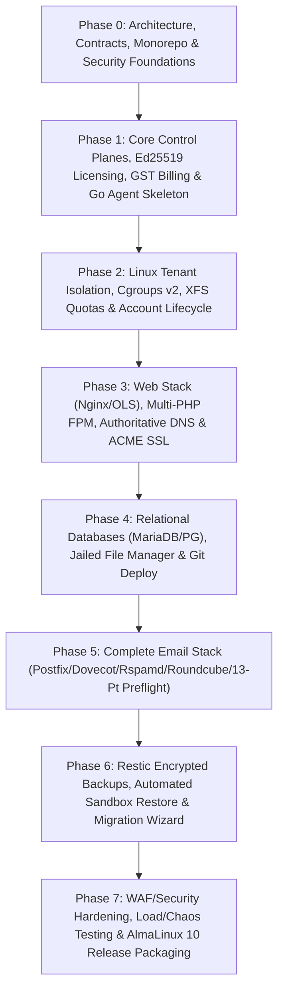

# 12 — Phased Implementation Roadmap (Phase 0 – Phase 7)

**Document ID:** `GHM-OPS-12`  
**Owner:** Garvix Software Solutions Pvt Ltd  
**Status:** Approved  

---

## 1. Executive Delivery Philosophy

Garvix Hosting Manager is delivered across **8 strictly gated engineering phases (Phase 0 through Phase 7)**. Each phase produces compilable, type-checked, unit/security-tested artifacts and passes quantitative acceptance gates (`docs/operations/13-acceptance-criteria.md`) before the next phase begins.

---

## 2. Granular Task Breakdown: Phase 0 & Phase 1

### Phase 0: Architecture, Monorepo Foundations & Shared Security Contracts
**Objective:** Establish the complete system blueprint, dual-plane PostgreSQL Prisma schemas, shared TypeScript packages, strict input/security validators, RBAC policy engine, and CI/container harness.

| Task ID | Deliverable / Module | Detailed Engineering Scope | Verification Gate |
| :--- | :--- | :--- | :--- |
| **`P0-T01`** | Architecture & ADR Suite | Author PRD (`00`), 4-Plane Architecture (`01`), IPC/Provisioning Flows (`02`), Module Dependencies (`03`), REST Contract (`05`), Email (`07`), Licensing/GST (`09`), Backups (`10`), ADRs `001`–`005`. | Architectural review & diagram syntax verification |
| **`P0-T02`** | Monorepo & TypeScript Workspace | Configure root `package.json`, `tsconfig.base.json`, strict compiler flags (`strict: true`, `noImplicitAny: true`, `noUncheckedIndexedAccess: true`), and workspace scripts. | `npm run typecheck` passes across all workspaces |
| **`P0-T03`** | `@garvix/shared-types` | Define canonical enums (`Role`, `AccountState`, `LicenseState`, `BackupState`, `ErrorCode`), capacity calculator models (4 vCPU / 16 GB RAM / 200 GB NVMe), and domain interfaces. | 100% type coverage + capacity calculation unit tests |
| **`P0-T04`** | `@garvix/validation` | Implement strict Zod validators for domains (RFC 1123), Linux usernames (`^ghm_[a-z0-9_]{3,24}$`), jail-safe relative paths (rejecting `..`, null bytes, symlink escapes), DNS records, Indian GSTIN Modulo-36 checksums, and command-injection rejection guards. | Fuzz & negative security test suite (path traversal, SQLi, shell metacharacters) |
| **`P0-T05`** | `@garvix/authorization` | Implement 9-role RBAC permission matrix, tenant ownership scope isolator, reseller boundary checks, and destructive action `StepUpAuthRequired` policy guard. | Cross-tenant isolation & privilege escalation unit tests |
| **`P0-T06`** | `@garvix/api-contracts` | Author typed REST request/response envelopes, pagination schemas, idempotency headers, and length-prefixed JSON-RPC 2.0 UDS schemas for `garvix-agentd`. | Contract schema validation tests |
| **`P0-T07`** | `@garvix/telemetry` | Build structured Pino logger with automatic secret redaction (passwords, JWTs, DKIM/Ed25519 private keys, Razorpay secrets) and SHA-256 hash-chained tamper-evident audit log builder. | Redaction & audit hash-chain tamper detection tests |
| **`P0-T08`** | Dual Prisma Schemas | Author isolated `prisma/cloud/schema.prisma` (`garvix_cloud`) and `prisma/local-panel/schema.prisma` (`garvix_local`) with strict indexes and foreign keys. | `npx prisma validate` passes on both schemas |

---

### Phase 1: Core Control Planes, Ed25519 Licensing, GST Billing & Go Agent Skeleton
**Objective:** Build the working Fastify services (`apps/cloud-api`, `apps/local-panel-api`), cryptographic Ed25519 licensing engine, Indian GST invoicing engine (SAC 998315), privileged Go agent skeleton (`apps/linux-agent`), and frontend console shells (`apps/cloud-console`, `apps/customer-panel`).

| Task ID | Deliverable / Module | Detailed Engineering Scope | Verification Gate |
| :--- | :--- | :--- | :--- |
| **`P1-T01`** | Ed25519 License & Release Signer (`apps/cloud-api`) | Implement Node `crypto` Ed25519 key generation, canonical JSON payload signing, 2-of-3 hardware fingerprint quorum verifier, 72-hour offline grace calculation, and non-destructive `EXPIRED_RESTRICTED` state resolver. | Cryptographic signature, tamper rejection, 72h grace, and non-destructive state unit tests |
| **`P1-T02`** | Indian GST Billing & Ledger Engine (`apps/cloud-api`) | Implement SAC `998315` tax engine: intra-state (`9% CGST + 9% SGST`), inter-state (`18% IGST`), export under LUT (`0%`), paise integer math, sequential FY numbering (`GHM/26-27/INV/xxxxxx`), Credit Note reversal, and Razorpay HMAC-SHA256 webhook verification. | Statutory tax calculation & webhook signature unit tests |
| **`P1-T03`** | Cloud Control Plane API (`apps/cloud-api`) | Wire Fastify routes for `/cloud/api/v1/servers/enroll`, `/cloud/api/v1/licenses/heartbeat`, `/cloud/api/v1/billing/invoices/calculate`, and `/cloud/api/v1/releases/latest`. | Fastify inject integration tests |
| **`P1-T04`** | Local Panel API (`apps/local-panel-api`) | Wire Fastify routes for `/api/v1/auth/*`, `/api/v1/packages`, `/api/v1/accounts`, `/api/v1/domains`, `/api/v1/mail/preflight-check`, `/api/v1/backups`, `/api/v1/jobs/{id}`, step-up MFA enforcement, and Mock/UDS Agent IPC client. | Fastify inject + RBAC + Step-Up MFA integration tests |
| **`P1-T05`** | Privileged Go Agent (`apps/linux-agent`) | Build Go daemon (`cmd/garvix-agentd`) with UDS listener (`/run/garvix/agent.sock`), `SO_PEERCRED` caller UID verifier, strict RPC method allowlist, transactional file snapshot/dry-run/rollback engine, and AlmaLinux 10 OS adapter. | Go syntax & structure verification + mock IPC contract parity |
| **`P1-T06`** | Cloud Console & Customer Panel UI (`apps/cloud-console`, `apps/customer-panel`) | Build shared accessible UI primitives (`@garvix/ui-components`) and Next.js App Router views for Server Capacity Planner, Hosting Accounts, Domains/SSL, Email 13-Point Preflight, Restic Backups, and Cloud Licensing/GST Invoices. | TypeScript compilation & component verification |
| **`P1-T07`** | Dev Environment & CI Pipeline | Provide `infrastructure/development/docker-compose.yml`, `infrastructure/containers/Dockerfile.almalinux10-test`, and `.github/workflows/ci.yml`. | Automated CI pipeline & test suite execution |

---

## 3. Summary of Subsequent Phases (Phase 2 – Phase 7)

### Phase 2: Linux Tenant Isolation, Cgroups v2, XFS Quotas & Account Lifecycle
- Implement real AlmaLinux 10 execution inside disposable privileged test containers (`Dockerfile.almalinux10-test`).
- Wire `useradd`, `/home/<user>` skeleton provisioning (`0710`), `systemd` `garvix-tenant-<id>.slice` (`CPUQuota`, `MemoryHigh`, `MemoryMax`, `IOWeight`, `TasksMax`), and `xfs_quota` project/user block & inode limits.
- Verify compensating rollback when any step of the 5-step account provisioning pipeline fails.

### Phase 3: Web Stack (Nginx/OLS), Multi-PHP FPM, Authoritative DNS & ACME SSL
- Render per-tenant PHP-FPM pools (`remi-php81`, `php82`, `php83`, `php84`) with dedicated Unix sockets and `open_basedir` confinement.
- Render Nginx HTTP/2 & HTTP/3 vhosts with `nginx -t` pre-reload validation and automatic snapshot rollback.
- Integrate PowerDNS Authoritative zone provisioning (`pdnsutil check-zone`), DNSSEC signing, and automated ACME Let's Encrypt HTTP-01/DNS-01 certificate lifecycle.

### Phase 4: Relational Databases (MariaDB/PG), Jailed File Manager & Git Deploy
- Implement isolated MariaDB 10.11 and PostgreSQL 16 database/user CRUD and privilege enforcement.
- Implement `openat2(RESOLVE_BENEATH | RESOLVE_NO_MAGICLINKS)` jailed file operations inside `garvix-agentd`, SFTP-only chroot configuration, and atomic symlink Git webhook deployments.

### Phase 5: Complete Email Stack (Postfix/Dovecot/Rspamd/Roundcube/13-Pt Preflight)
- Configure Postfix virtual mailbox domains, Dovecot LMTP/IMAP with Argon2id password verification, Rspamd milter with dual 2048-bit RSA + Ed25519 DKIM signing, and Redis-backed per-user/per-domain outbound rate limits.
- Wire the live 13-Point Mail Deliverability Preflight Check and seamless Outbound SMTP Relay fallback for port-25-blocked VPS nodes.

### Phase 6: Restic Encrypted Backups, Automated Sandbox Restore & Migration Wizard
- Orchestrate scheduled Restic encrypted backups (local + S3/B2/R2/SFTP) with pre-backup `mariadb-dump` / `pg_dump` staging.
- Enforce the automated ephemeral sandbox restore verification pipeline before transitioning snapshots from `SNAPSHOT_CREATED` to `VERIFIED`.
- Deliver the 5-Phase Staged Migration Wizard for cPanel (`cpmove`) and native GHM archives.

### Phase 7: WAF/Security Hardening, Chaos Testing & AlmaLinux 10 Release Packaging
- Integrate ModSecurity + OWASP CRS v4 ruleset toggles, Fail2ban jails, ClamAV scanning, SELinux policy modules (`garvix-agent.pp`), RPM/DNF packaging, and 72-hour soak/chaos verification on a 4 vCPU / 16 GB RAM / 200 GB NVMe AlmaLinux 10 staging node.
