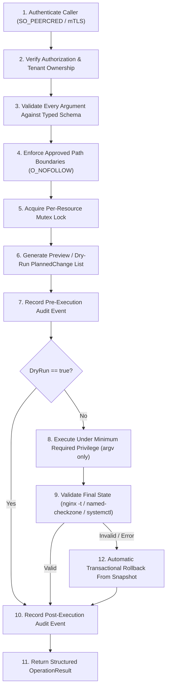

# 06 — Privileged Linux Agent Security Architecture

**Product:** Garvix Hosting Manager  
**Organization:** Garvix Software Solutions Pvt Ltd  
**Target OS:** AlmaLinux 10 (Tier-1)  
**Agent Implementation:** [`agents/linux-agent`](file:///Users/vishnubaldwa/Documents/cpanel/agents/linux-agent/go.mod)

---

## 1. Core Security Philosophy: Zero Arbitrary Root Execution

Traditional hosting control panels frequently suffer from catastrophic privilege escalation vulnerabilities because their web control plane invokes root shell scripts (`sh -c "..."`) or passes unsanitized user strings to `sudo`.

**Garvix Hosting Manager strictly forbids arbitrary command or shell execution:**
1. **Unprivileged Control Plane**: The Node.js/Fastify web control plane runs as an unprivileged service user (`garvix-panel`, UID `990`) inside a hardened systemd unit (`NoNewPrivileges=yes`, `ProtectSystem=strict`, `PrivateTmp=yes`). It has zero `sudo` rules and zero direct write access to `/etc`, `/home`, or `/var/named`.
2. **Closed Allowlist RPC Contract**: The privileged Go daemon (`garvix-agent`) only accepts structured JSON RPC requests matching the 26 explicitly enumerated [`OperationName`](file:///Users/vishnubaldwa/Documents/cpanel/agents/linux-agent/internal/protocol/types.go#L22-L50) operations.
3. **Explicit `argv` Execution (`exec.CommandContext`)**: Every external system utility (`/usr/sbin/useradd`, `/usr/sbin/nginx`, `/usr/sbin/named-checkzone`, `/usr/bin/systemctl`) is invoked via Go's `exec.CommandContext(ctx, binaryPath, argv...)` without invoking `/bin/sh` or `/bin/bash`.

---

## 2. Transport Authentication: `SO_PEERCRED` & Short-Lived mTLS

### 2.1 Local Control Plane (`UDS_SO_PEERCRED`)
On a single-server deployment, `garvix-agent` listens on the Unix domain socket `/run/garvix-agent/agent.sock` (`0660`, owned by `root:garvix-panel`):
- When a client connects, the agent extracts kernel-verified peer credentials (`SO_PEERCRED` on Linux `syscall.GetsockoptUcred`) containing the caller's `PID`, `UID`, and `GID`.
- Only `UID 990` (`garvix-panel`) and `UID 0` (`root` emergency administrative CLI) are permitted in [`DefaultAgentPolicy`](file:///Users/vishnubaldwa/Documents/cpanel/agents/linux-agent/internal/registry/registry.go#L35-L120). Any connection from a tenant UID (`>= 1000`) is rejected before payload evaluation.

### 2.2 Multi-Server Cluster Nodes (`MTLS_CLIENT_CERT`)
When the control plane communicates with remote `garvix-agent` nodes:
- All RPC calls require **TLS 1.3 with mutual TLS (mTLS)** using Ed25519 / ECDSA P-256 certificates issued by the internal Garvix Control Plane CA.
- Client certificates have a maximum lifetime of **24 hours** and are pinned by SHA-256 fingerprint (`MTLSCertFingerprint`) and Subject Common Name (`MTLSSubjectCN`).

---

## 3. The Mandatory 12-Step Execution Pipeline

Every operation executed by [`Pipeline.Execute`](file:///Users/vishnubaldwa/Documents/cpanel/agents/linux-agent/internal/registry/registry.go#L172-L295) enforces an immutable 12-step pipeline:

| Step | Enforcement Function | Security Guarantee |
| :--- | :--- | :--- |
| **1** | `step1AuthenticateCaller` | Kernel `SO_PEERCRED` UID verification or mTLS certificate fingerprint validation. |
| **2** | `step2AuthorizeAndVerifyTenant` | Role-to-operation RBAC check and cross-tenant ownership verification (`TenantOwnershipMap`). |
| **3** | `step3ValidateSchema` | Strict regex validation of identifiers (`^[a-z][a-z0-9_-]{1,31}$`), domains, UIDs (`1000..60000`), and shell metacharacter rejection (`RejectShellMetacharacters`). |
| **4** | `step4EnforcePathBoundaries` | Confinement under `/home/<linux_username>` with ancestor `Lstat`, `filepath.EvalSymlinks`, and `O_NOFOLLOW` descriptor check. |
| **5** | `acquireResourceLock` | Per-resource mutex (`ResourceKey`, e.g., `vhost:example.com`) preventing concurrent race conditions. |
| **6** | `spec.PlanChanges` | Deterministic generation of `[]PlannedChange` and SHA-256 `planned_change_hash`. |
| **7** | `auditSink.Record(PRE_EXECUTION)` | Append-only audit record persisted before any host state is touched. |
| **8** | `step8ExecutePlannedChanges` | Executes explicit `argv` slices under least privilege (`postgres` UID 26, `dovecot` UID 97, `named` UID 25, or tenant UID). |
| **9** | `step9ValidateFinalState` | Runs syntax/health verifiers (`nginx -t`, `named-checkzone`, `systemctl is-active`). |
| **10** | `recordPostAuditAndFinalize` | Records final outcome, duration, and rollback status to the audit trail. |
| **11** | `OperationResult` return | Returns structured telemetry and `PlannedChange` receipt to the control plane. |
| **12** | `step12RollbackFromSnapshot` | Automatically restores snapshots and runs inverse rollback commands if Step 8 or Step 9 fails. |

---

## 4. `O_NOFOLLOW` Path Confinement & Symlink Escape Defense

In shared Linux hosting, a classic privilege escalation vector is the **symlink / TOCTOU race**: a tenant creates `/home/acmeweb/public_html/config.php` as a symlink pointing to `/etc/shadow` or `/home/victim/wp-config.php` right before the privileged agent chowns or writes to it.

[`internal/security/pathguard.go`](file:///Users/vishnubaldwa/Documents/cpanel/agents/linux-agent/internal/security/pathguard.go) eliminates this class of vulnerability:
1. **Lexical & Traversal Rejection**: [`ValidateAccountPath`](file:///Users/vishnubaldwa/Documents/cpanel/agents/linux-agent/internal/security/pathguard.go#L140-L176) rejects non-absolute paths, `..` segments, NUL bytes, and any path that does not resolve inside `/home/<linux_username>`.
2. **Component-by-Component `os.Lstat` Walk**: [`RejectSymlinkEscape`](file:///Users/vishnubaldwa/Documents/cpanel/agents/linux-agent/internal/security/pathguard.go#L182-L253) walks every directory component from `/home/<linux_username>` down to the target path and fails immediately with `ErrSymlinkEscape` if any segment has `os.ModeSymlink` set.
3. **Kernel `O_NOFOLLOW | O_CLOEXEC` Verification**: Opens the deepest existing ancestor using `syscall.Open(..., syscall.O_RDONLY|syscall.O_NOFOLLOW|syscall.O_CLOEXEC, 0)` and verifies `filepath.EvalSymlinks` matches the canonical tenant boundary.

---

## 5. Template-Based Configuration Generation

The agent never concatenates raw user strings into configuration files:
- **Nginx Virtual Hosts**: Generated from compiled Go AST templates where `server_name`, `root`, `fastcgi_pass unix:/run/php-fpm/<username>.sock`, and TLS paths are validated against RFC-1123 and `ValidateAccountPath` prior to rendering. Written atomically to a staging file, tested with `/usr/sbin/nginx -t`, and rolled back automatically if syntax validation fails.
- **BIND9 / PowerDNS Zones**: Rendered via typed resource record structs and verified with `/usr/sbin/named-checkzone <zone> <zonefile>` prior to reload.

---

## 6. Systemd Cgroup v2 Resource Slices

Every tenant hosting account is placed inside a dedicated systemd cgroup v2 slice (`garvix-tenant-<uid>.slice`) on AlmaLinux 10:
- `CPUQuota=` (e.g., `100%` per allocated vCPU core)
- `MemoryMax=` and `MemoryHigh=` (prevents OOM killer from impacting the control plane or sibling tenants)
- `TasksMax=` (mitigates fork bombs inside PHP-FPM, Node.js, or Python tenant workers)
- `IOWeight=` (prevents disk I/O starvation on NVMe/SSD storage)
